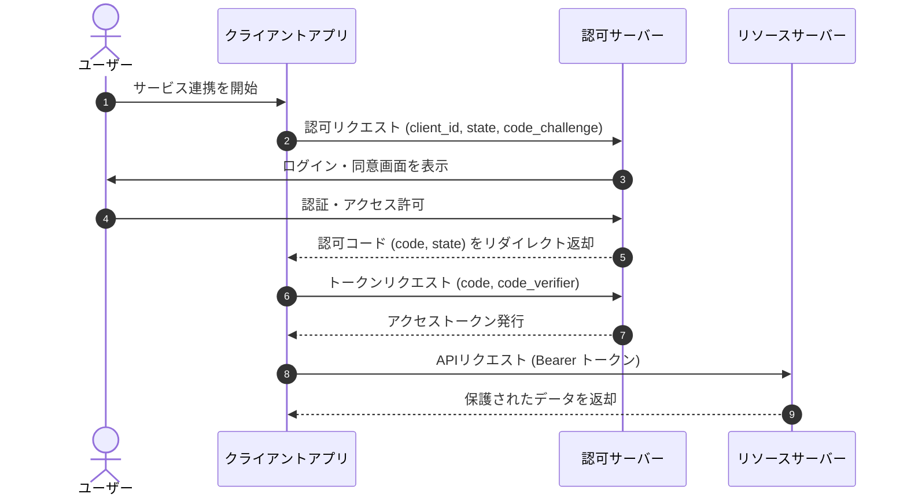
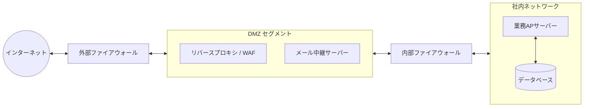

---
# src/content/glossary/oauth2.mdx
title: "OAuth 2.0"
reading: "おーおーす2"
category: "auth"
summary: "パスワードを渡さずに、第三者アプリへリソースへのアクセス権限を委譲するための認可フレームワーク。"
updatedAt: 2026-11-22
---
import Callout from '../../components/Callout.astro';

## 概要

OAuth 2.0 は「認証（Authentication）」ではなく**「認可（Authorization）」**の仕組みです。

<Callout type="point" title="支援士（SC）午後試験での頻出論点">
  認可コードグラントにおいて、リダイレクト時のCSRFを防ぐ `state` パラメータと、認可コード横取り攻撃を防ぐ **PKCE** の役割はセットで問われます。
</Callout>

<Callout type="warning">
  アクセストークンをブラウザの `localStorage` に保存すると、XSS（クロスサイトスクリプティング）が発生した際にトークンを窃取されるリスクがあります。
</Callout>